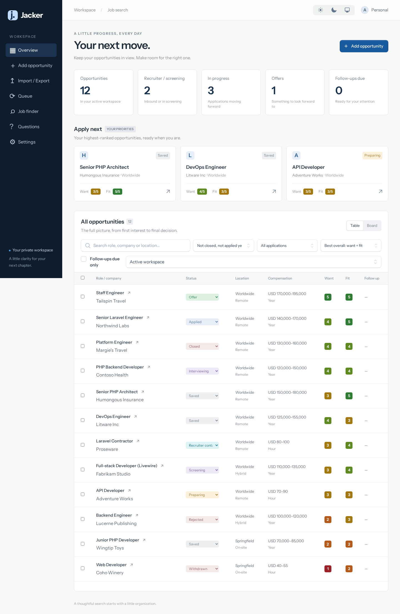

# Jacker

[](https://github.com/loki495/jacker/actions/workflows/ci.yml)

A private, single-user job application tracker built with Laravel 13, Livewire 4, free Flux UI, Tailwind CSS 4, and SQLite.

Track opportunities from saved roles through interviews and offers. Import and export CSV, discover remote jobs, check posting links, record interview answers, and keep a cover letter for each application. Rank jobs by skill match and desirability, with optional AI extraction, grading, and letter suggestions through a host bridge or provider API.

**Private access is required.** Jacker has no login. Use a trusted network or an authenticated reverse proxy; do not expose it directly to the internet.

## Screenshots

All screenshots use fake demo data.



[Opportunity detail and cover letter](docs/screenshots/detail.png) · [Background-work queue](docs/screenshots/queue.png)

## Quick start

Install Docker Engine and Docker Compose; host PHP, Composer, and Node are not required.

```sh
cp .env.example .env
chmod 600 .env
docker compose build app
docker compose up -d app
docker exec --user www-data jacker-app composer install --no-interaction
docker exec --user www-data jacker-app php artisan key:generate
touch database/database.sqlite
docker exec --user www-data jacker-app php artisan migrate --force
docker compose --profile tools run --rm node npm ci
docker compose --profile tools run --rm node
```

Open <http://localhost:8096>. The default port binds only to loopback. Set `APP_PORT` and `APP_URL` if you change it. Match `APP_UID`/`APP_GID` to the repository owner before building. Keep `storage/` and `bootstrap/cache/` writable by that user.

Start background processing with `docker compose up -d queue`. Host-bridge AI and browser page rendering also need the optional [host bridge](docs/features.md). API processing and similarities remain opt-in; no API key is needed for ordinary tracking.

## Documentation

- [Features and background work](docs/features.md)
- [Access and configuration](docs/configuration.md)
- [Architecture and AI request lifecycle](docs/architecture.md)
- [CSV behavior and limits](docs/csv.md)
- [Development, quality checks, and demo data](docs/development.md)
- [Contributing](CONTRIBUTING.md), [security policy](SECURITY.md), [changelog](CHANGELOG.md), [MIT license](LICENSE)
