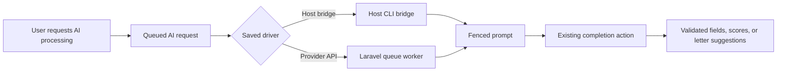

# Architecture

Jacker is a Laravel application with Livewire 4 single-file class pages and free Flux components. Livewire provides Alpine. Vite builds versioned CSS and JavaScript; the root font-size multiplier and light/dark palettes live in `resources/css/`.

## Application and persistence

Pages validate browser input and call typed actions. Actions own business rules and transactions; services perform third-party IO. `Opportunity` uses the `opportunities` table, separate from Laravel's queue `jobs` table. Settings store non-secret values as JSON; credentials belong in `.env`.

SQLite holds opportunities, status history, staged found jobs, link checks, cover letters, interview questions and answers, AI request logs, and the optional similarity index. CSV imports are reviewed before writing; saves and lifecycle history share a transaction. PDF rendering is local. The application has no authentication: a private network or authenticated proxy is the access boundary.

## AI requests

Extraction, job grading, and letter suggestions share `ai_requests`. Each request snapshots its processing driver; API requests also retain the provider and model selected when queued. Changing Settings applies to future requests.

The bridge claims only bridge requests. `ProcessAiRequest` claims one exact API request using a status-guarded update; duplicate jobs cannot run it twice. API calls use the stateless `JobAssistant` agent with no registered tools or conversation storage. No SDK conversation migrations are required. Each API request uses one explicitly selected Anthropic or OpenAI provider; it does not silently fall back to another provider. The bridge retains its existing configured CLI fallback chain.

A fetched page is rendered by the host bridge before extraction. An API extraction waits while that render is pending. Render completion or failure dispatches the waiting extraction again; on failure it uses the existing page text, and an empty source fails without calling AI. Saved-page imports skip browser rendering. API text processing therefore still needs the host bridge for live-page rendering.

Every prompt fences untrusted source text with a fresh random token and defuses marker-like content. Completion actions validate the response regardless of driver: extraction whitelists fields and preserves prior replaceable values, grading validates skill match and computes desirability in PHP, and letter suggestions never replace the draft. Missing keys and provider errors finish the request as failed. Unexpected errors are reported and surface in local/debug environments. Queue failures also mark API requests failed.

## Similarity experiment

The opt-in similarity index stores job and letter vectors in `content_embeddings`. OpenAI embeddings are generated by queued jobs only after enabling the feature; existing records need an explicit indexing request. Source hashes prevent repeat calls for unchanged content, and an overlap lock serializes jobs for one opportunity. Meaningful job or draft edits enqueue updates; changes to scores or AI suggestions do not.

The detail page compares compatible vectors using cosine similarity in PHP. It excludes the current job, archived jobs, stale content, invalid vectors, and vectors made with different providers, models, or dimensions. Similar jobs and past letters appear as links. Matching content is never automatically inserted into prompts. Disable the feature to stop generation and hide matches; existing index rows remain in SQLite and are included in backups.

## Background services and tests

The `jacker-app` container serves HTTP. `jacker-queue` processes Laravel jobs. `bin/ai-bridge` runs on the host for bridge requests and isolated browser rendering. Restart the queue service after changing queued code or provider configuration.

Pest runs only against guarded SQLite `:memory:`. SDK tests use the SDK fakes with stray calls blocked; browser screenshots use disposable demo data. See [development](development.md) for the ordered quality gate and coverage floor.
